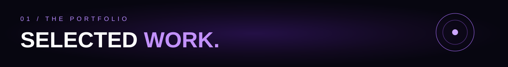
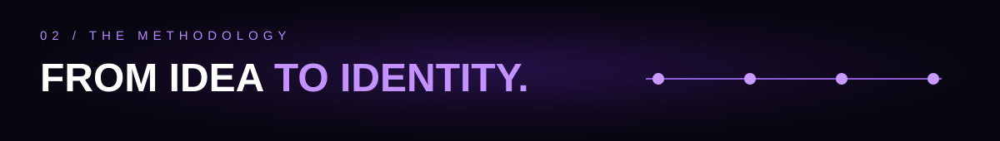

 

**BRAND & VISUAL IDENTITY DESIGNER** &nbsp; ✦ &nbsp; **BASED IN MOROCCO**

### I build visual identities that people remember.

*Strategy · Logo design · Visual identity systems · Brand applications*

 

<table>
<tr>
<td width="33%" align="center"> <h3>01 · VANDARI</h3><b>Premium French butcher</b> Brand identity & applications  <a href="https://www.behance.net/tahiriothmane">Explore on Behance ↗</a></td>
<td width="33%" align="center"> <h3>02 · UniStay</h3><b>Student housing</b> Logo & visual identity  <a href="https://www.behance.net/tahiriothmane">Explore on Behance ↗</a></td>
<td width="33%" align="center"> <h3>03 · Saffron Lane</h3><b>Restaurant identity</b> Branding & applications  <a href="https://www.behance.net/tahiriothmane">Explore on Behance ↗</a></td>
</tr>
</table>

<table>
<tr><th align="center">01 / DISCOVER</th><th align="center">02 / DEFINE</th><th align="center">03 / DESIGN</th><th align="center">04 / DELIVER</th></tr>
<tr><td align="center">Understand the brand and its audience</td><td align="center">Set strategy and creative direction</td><td align="center">Craft the identity system</td><td align="center">Prepare applications and files</td></tr>
</table>

Process is a temporary overview and will be updated to reflect my complete client workflow.

  

### ✦ 03 / CREATIVE TOOLKIT

*The tools I use to bring ideas into visual identities.*

 

OT / CREATIVE UNIVERSE — DESIGN WITH PURPOSE, BUILT TO BE REMEMBERED.

